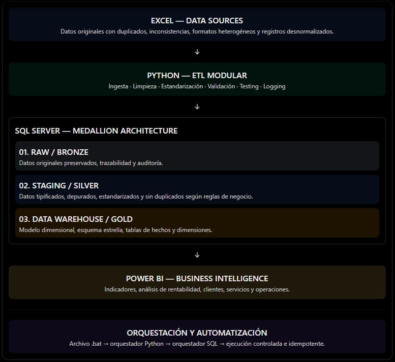

# 🧖 Hammam Wellness Data Quality Pipeline

### Modular ETL · Data Quality · SQL Server Data Warehouse · Power BI


---

## 1. Descripción del proyecto

**Hammam Wellness Data Quality Pipeline** es un proyecto de ingeniería de datos orientado a mejorar la calidad, consistencia y trazabilidad de la información operativa de un centro de bienestar.

El problema se origina en el registro manual de información mediante múltiples archivos Excel, que presentan:

- Registros duplicados de clientes y transacciones.
- Datos personales y categorías con formatos inconsistentes.
- Valores faltantes y errores de digitación.
- Información desnormalizada y distribuida entre archivos.
- Inconsistencias al relacionar clientes, servicios y transacciones.

Estas deficiencias dificultan la conciliación de información y pueden generar indicadores incorrectos en los reportes del negocio.

**Solución:** desarrollar un pipeline ETL modular en Python que depure, estandarice y valide los datos antes de almacenarlos en SQL Server. Posteriormente, se implementará un Data Warehouse dimensional que servirá como fuente para el dashboard existente en Power BI.

## 2. Arquitectura de la solución

Se utilizará una arquitectura Medallion de tres capas para organizar el procesamiento de los datos:

| Capa | Responsabilidad |
|---|---|
| **Bronze (RAW)** | Conservar los datos originales y registrar su procedencia e ingesta. |
| **Silver (STAGING)** | Limpiar, tipificar, estandarizar y validar los datos. |
| **Gold (Data Warehouse)** | Organizar la información en un modelo dimensional mediante un esquema en estrella. |

### Flujo de procesamiento




## 3. Componentes y responsabilidades

### 3.1. Python — Modular ETL

Se implementará un proceso ETL dividido en módulos independientes:

- **Ingestion:** lectura y extracción de archivos Excel.
- **Transformations:** limpieza y transformación de datos.
- **Standardization:** normalización de formatos, nombres y categorías.
- **Validation:** aplicación de reglas de calidad e integridad.
- **Matching:** identificación y conciliación de registros de clientes.
- **Loading:** preparación y carga de información hacia SQL Server.
- **Orchestration:** coordinación de las etapas del pipeline.
- **Utils:** funciones reutilizables y herramientas comunes.

### 3.2. SQL Server — Data Warehouse

Se desarrollarán scripts SQL y procedimientos almacenados organizados por responsabilidad:

- Creación y administración de la base de datos.
- Tablas RAW para conservar los registros de origen.
- Tablas STAGING para procesar información validada.
- Dimensiones y tablas de hechos.
- Restricciones de integridad y relaciones.
- Procedimientos de carga y transformación.
- Tablas de auditoría y seguimiento de ejecuciones.

El modelo dimensional utilizará un esquema en estrella para facilitar las consultas analíticas y la integración con Power BI.

### 3.3. Cargas idempotentes

Los procesos de carga deberán permitir ejecuciones repetidas sin insertar nuevamente los mismos registros de negocio.

Se implementarán mecanismos como:

- Claves de negocio y restricciones únicas.
- Identificación de archivos y lotes procesados.
- Control de registros previamente cargados.
- Operaciones de inserción y actualización controladas.
- Transacciones y mecanismos de recuperación.
- Auditoría de ejecuciones y resultados.

La idempotencia se evaluará tanto en la ingesta como en las cargas hacia el Data Warehouse.

### 3.4. Automatización

Un archivo principal `.bat` permitirá ejecutar el proceso completo:

1. Verificar el entorno y las dependencias.
2. Ejecutar el pipeline Python.
3. Validar los resultados.
4. Iniciar la carga hacia SQL Server.
5. Ejecutar el orquestador `master.sql`.
6. Registrar resultados y controlar errores.
7. Finalizar con un código de salida según el resultado.

### 3.5. Power BI

Se adaptará el dashboard existente para utilizar el nuevo Data Warehouse como fuente de información, conservando sus indicadores y funcionalidades relevantes.

Se verificará que las métricas anteriores mantengan su significado y que los resultados coincidan con los datos procesados.

## 4. Tecnología y herramientas

| Tecnología | Aplicación |
|---|---|
| Python | Desarrollo del pipeline ETL |
| Pandas / NumPy | Manipulación y transformación de datos |
| OpenPyXL | Lectura de Excel |
| SQLAlchemy / pyodbc | Conexión con SQL Server |
| SQL Server / T-SQL | Almacenamiento y procesamiento |
| Pytest | Pruebas automatizadas |
| Ruff | Análisis y formato del código |
| Python-dotenv | Gestión de variables de entorno |
| Logging | Registro de eventos y errores |
| Git / GitHub | Control de versiones |
| GitHub Actions | Integración continua |
| Windows Batch | Automatización de ejecución |
| Power BI | Análisis y visualización |

## 5. Buenas prácticas de desarrollo

El proyecto seguirá los siguientes principios:

- **Modular Programming:** separación de responsabilidades.
- **DRY:** reutilización de funciones y reducción de código duplicado.
- **Single Responsibility Principle:** cada módulo tendrá una responsabilidad definida.
- **Separation of Concerns:** separación entre configuración, lógica de negocio, validación y persistencia.
- **Environment Management:** aislamiento de dependencias mediante entornos virtuales.
- **Configuration Management:** gestión de parámetros mediante variables de entorno.
- **Data Quality:** reglas explícitas de validación e integridad.
- **Unit & Integration Testing:** pruebas de funciones y componentes integrados.
- **Logging & Exception Handling:** trazabilidad y control de errores.
- **Documentation:** documentación técnica, docstrings.
- **Conventional Commits:** historial de cambios organizado y descriptivo.
- **Idempotent Processing:** cargas repetibles y controladas.

### Integración continua y control de versiones

Se utilizará GitHub Actions para automatizar las verificaciones del proyecto ante cambios en las ramas configuradas y solicitudes de integración hacia `main`.

El workflow de CI ejecutará:

1. Instalación de Python y dependencias.
2. Verificación estática mediante `ruff check`.
3. Comprobación de formato mediante `ruff format --check`.
4. Ejecución de pruebas con Pytest.

La rama principal `main` estará protegida mediante reglas de protección que exigirán que las verificaciones de calidad finalicen correctamente antes de permitir un merge.

## 6. Estructura del proyecto

```text
config/          Configuración de la aplicación
data/            Archivos de entrada y resultados
docs/            Documentación técnica
sql/             Scripts SQL y procedimientos
src/             Código modular del pipeline
tests/           Pruebas unitarias y de integración
scripts/         Automatización y ejecución
logs/            Registros de procesamiento
.github/         Workflows de integración continua
.gitignore       Archivos excluidos de Git
pyproject.toml   Configuración del proyecto
requirements.txt Dependencias de Python
run.py           Punto de entrada de la aplicación
```

Los archivos originales y los datos sensibles no se publicarán en el repositorio.

## 7. Hoja de ruta

- [x] Creación del repositorio y descripción inicial.
- [x] Estructura inicial del proyecto.
- [x] Configuración del entorno virtual y dependencias.
- [x] Configuración de `pyproject.toml`, Ruff y Pytest.
- [x] Configuración de GitHub Actions y protección de `main`.
- [ ] Auditoría y modularización del código Python existente.
- [ ] Implementación de ingesta y transformaciones.
- [ ] Estandarización y conciliación de clientes.
- [ ] Validaciones y pruebas automatizadas.
- [ ] Implementación de RAW y STAGING en SQL Server.
- [ ] Modelado dimensional y esquema en estrella.
- [ ] Cargas idempotentes y auditoría.
- [ ] Orquestación SQL mediante `master.sql`.
- [ ] Automatización integral mediante `.bat`.
- [ ] Integración y validación del dashboard Power BI.
- [ ] Documentación y pruebas finales.

## 8. Resultado esperado

Obtener una solución reproducible y mantenible que permita:

- Mejorar la calidad y consistencia de los datos operativos.
- Reducir duplicados e inconsistencias.
- Centralizar la información en SQL Server.
- Disponer de un Data Warehouse con modelo dimensional.
- Ejecutar cargas automatizadas e idempotentes.
- Mantener trazabilidad y control de errores.
- Alimentar reportes confiables en Power BI.

## 9. Autor

**Wilmer Lozano**

Data Analyst | Data Engineering | Business Intelligence

GitHub: [WLozanoH](https://github.com/WLozanoH)

---

*Proyecto práctico de ingeniería de datos aplicado a la gestión y análisis de información de un centro de bienestar.*